<p align="center">
  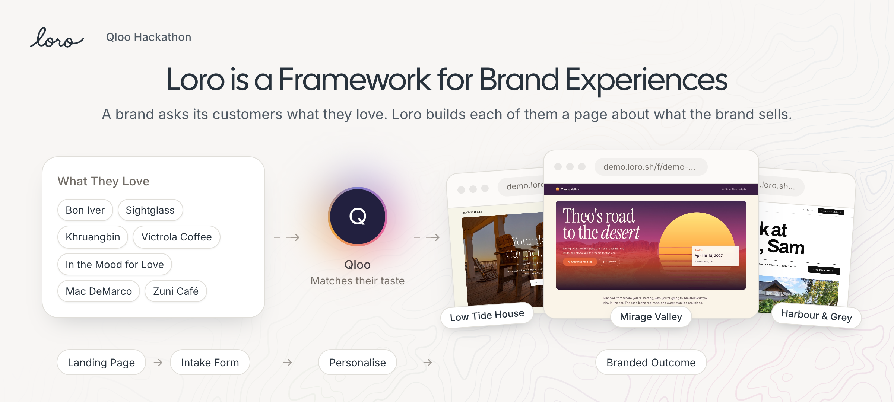
</p>

<h1 align="center">Loro</h1>

<p align="center">
  <strong>Open source.</strong> A framework for brand experiences, built on <a href="https://www.qloo.com">Qloo</a> taste data, that runs as one Cloudflare Worker on the brand's own account.
</p>

<p align="center">
  <a href="LICENSE"></a>
  
  
  
</p>

<p align="center">
  <a href="https://loro.sh">Site</a> ·
  <a href="https://demo.loro.sh/f/demo-experiences/mirage-valley-road-trip">Live Demo</a> ·
  <a href="https://app.loro.sh">Admin (read only)</a> ·
  <a href="#deploy">Deploy</a>
</p>

<p align="center">
  <a href="https://deploy.workers.cloudflare.com/?url=https://github.com/impactvelocity/loro-sh/tree/main/worker"></a>
</p>

---

A brand asks its customers what they love, and Loro builds each of them a page about what the brand sells: a road trip to its festival, a weekend at its cottage, a week in the house it's selling.

Each page needs three things: what the brand sells, who the person is, and what that person loves. Brands already have the first two. Qloo has the third. Loro puts them together, and every place, act and show on the page comes from Qloo or a brand's own data. Anything the model invents is dropped before the page shows it.

Loro was built for the [Qloo hackathon](https://qloo.devpost.com/).

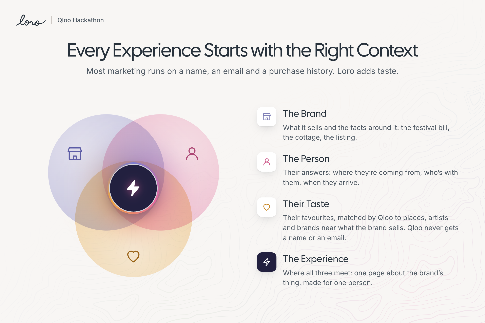

## Contents

- [What It Does](#what-it-does)
- [Try It](#try-it)
- [How It Works](#how-it-works)
- [What's in the Repo](#whats-in-the-repo)
- [Run It Locally](#run-it-locally)
- [Deploy](#deploy)
- [Build Your Own Experience](#build-your-own-experience)
- [API and MCP](#api-and-mcp)
- [License](#license)

## What It Does

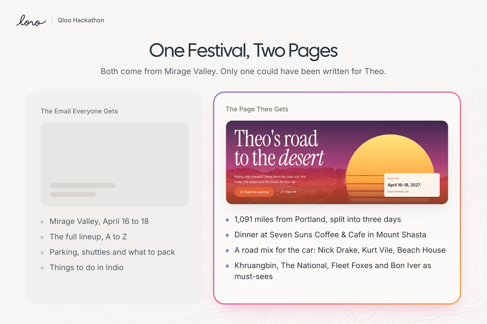

A festival sells a ticket, then goes quiet until the gates open. Every ticket holder gets the same email: the dates, the lineup from A to Z, parking and what to pack. Theo, a made-up ticket holder in the demo, still has 1,091 miles to drive from Portland. Nothing in that email knows it.

Theo signs up on the page for Mirage Valley, a made-up festival in Indio, California, and answers eight questions, from where the drive starts to what's playing in the car. Then, in one run:

- Qloo turns Theo's seven favourites into twenty picks.
- A route step splits the 1,091 miles into three days, each ending in a town worth a night.
- A lineup step scores the festival's bill against Theo's taste in one Qloo call and marks four must-sees.
- The model writes nine stops in the festival's voice, each with a reason it's there.

Neil Young, Fleetwood Mac and Bon Iver lead to Seven Suns Coffee & Cafe in Mount Shasta. The page streams in section by section, in Mirage Valley's own look.

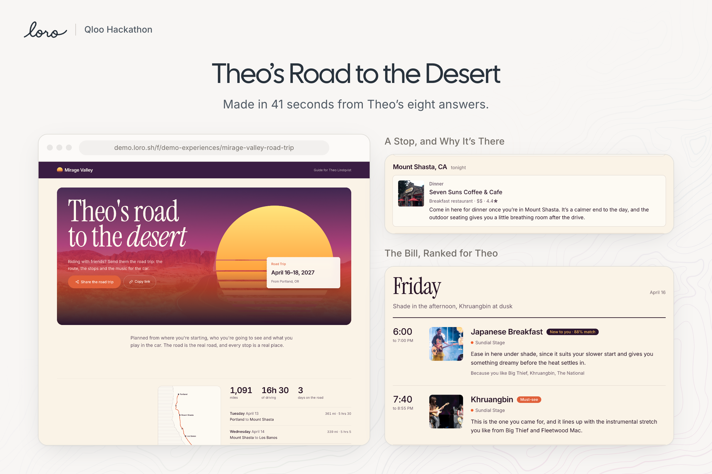

### Two Ways In

An experience starts one of two ways. Someone signs up on the brand's page and answers its questions. Or the brand's own system calls `POST /trigger` after a booking, a match or a ticket sale, sends the answers it already has, and gets the page's link back.

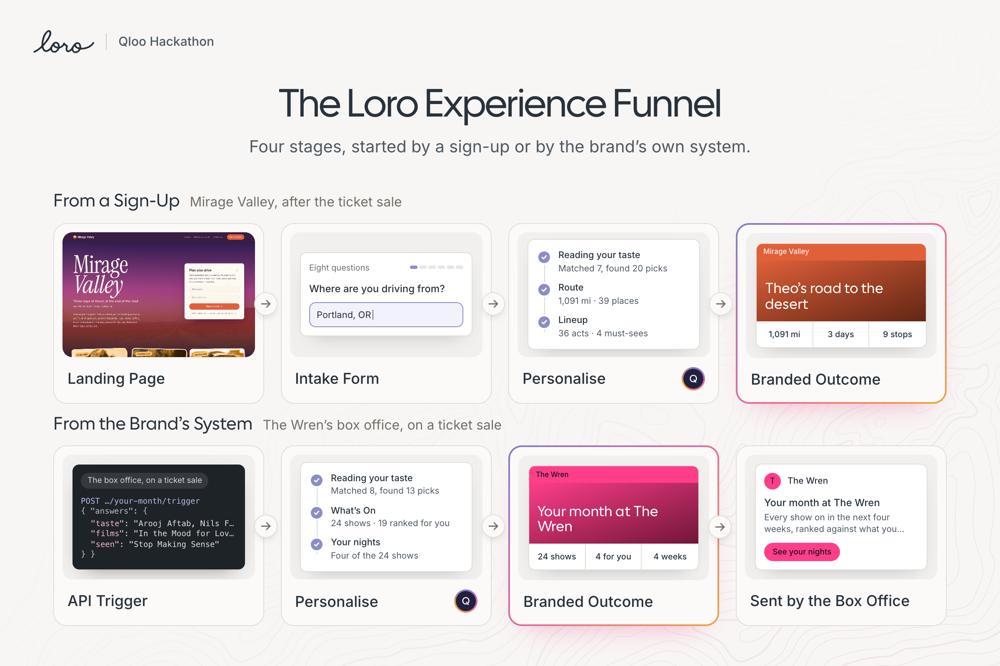

### Six Brands, One Core

The demo has six made-up brands in six industries. The same core runs all of them. Only the catalogue, the code steps and the theme change.

| Brand | Industry | When it runs | What the person gets |
| --- | --- | --- | --- |
| **Mirage Valley** | Music festival | After the ticket sale | A road trip to the desert, and a weekend guide planned set by set |
| **Harbour & Grey** | Real estate | On the listing page | A buyer's week in the house, with their coffee shop swapped for one nearby |
| **Low Tide House** | Holiday rental | After the booking | Three nights in Carmel, planned around the dog |
| **Fieldhouse Realty** | Buyer's agency | When the agent finds a home | The buyer's week, moved to the new neighbourhood, from a listing link |
| **The Wren** | Live venue | Between shows | Four nights from the next 24 shows, with dinner a short walk from the doors |
| **Overlap** | Dating app | When two people match | A first date, four stops a walk apart |

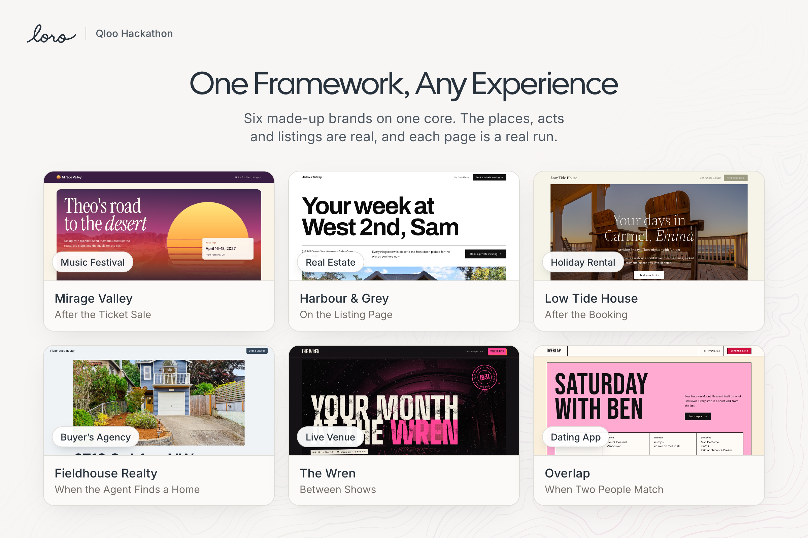

### The Loro App

Each brand gets a workspace in the admin.

- **Analytics**: views, sign-ups and finished pages per experience, counted without names or emails.
- **Profiles**: everyone who signed up, with their answers, taste and pages, grouped into segments.
- **Experiences**: an editor for the start page, questions and outcome with a phone preview beside it, and Tests that run the unsaved draft as a real profile.
- **Context**: the brand's skills (its voice and its rules, in plain English) and its photo and video library.
- **Agent**: ask about any profile, segment or experience. It asks before it changes anything.
- **Connect**: the REST API, an MCP server with 31 tools, and the keys for both.

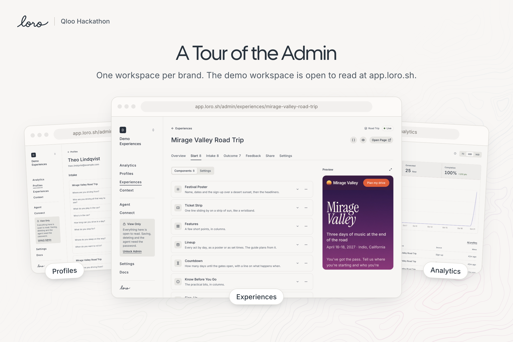

## Try It

No account needed.

- **[Mirage Valley Road Trip](https://demo.loro.sh/f/demo-experiences/mirage-valley-road-trip)**: sign up and answer the questions, or open a sample profile to watch a new page made live.
- **[Low Tide House](https://demo.loro.sh/f/demo-experiences/plan-your-stay)**: a stay planned after a booking.
- **[Harbour & Grey](https://demo.loro.sh/f/demo-experiences/2-3768-west-2nd-avenue)**: a buyer's week in a listing.
- **[The Admin](https://app.loro.sh)**: open to read. Every action asks for the admin password.

Add `?profile=<id>&skip=1` to an experience link to run it as one of its sample people and jump straight to the live page.

## How It Works

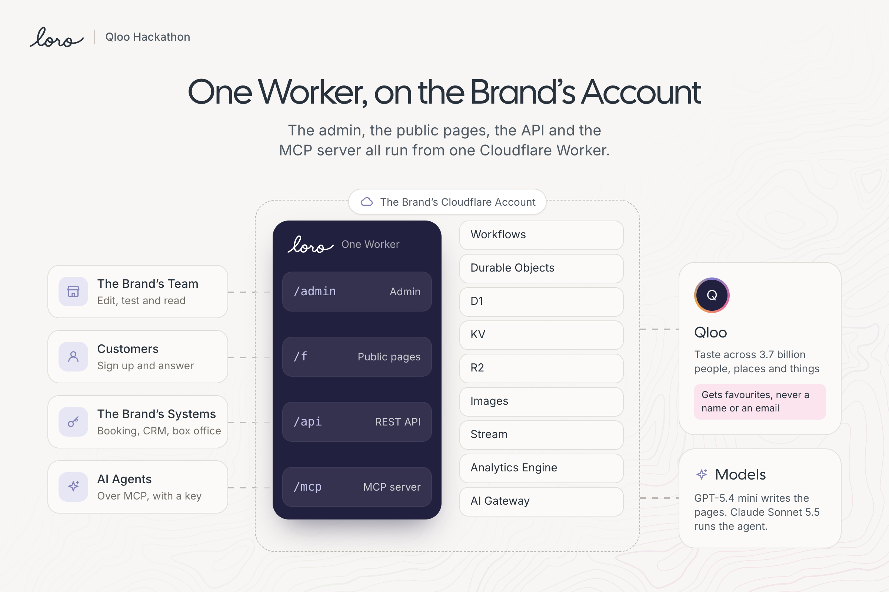

Loro is one Cloudflare Worker. Hono serves the REST API and the MCP server, React Router v8 renders the admin and the public pages, and the admin is built with shadcn on Base UI and Tailwind v4.

| Cloudflare product | What Loro uses it for |
| --- | --- |
| **D1** | One database for every workspace: profiles, answers, segments, experiences and every finished page |
| **Workflows** | One durable run per page, saved step by step, so a failed section retries on its own |
| **Durable Objects** | One room per run, streaming each section to the browser as server-sent events |
| **KV** | A cache of the public start pages, cleared on save |
| **Images** and **Stream** | The brand's photos and video |
| **R2** | Audio |
| **Analytics Engine** | Views and sign-ups, with no personal data |
| **AI Gateway** | Every model call: GPT-5.4 mini writes outcomes, Claude Sonnet 5.5 runs the admin agent |
| **Browser Rendering** | Reads listing pages that turn away a plain fetch |

### How a Page Gets Made

Every run goes in the same order: taste first, then the brand's own code, then the writing.

1. **Taste.** Loro sends a person's favourites to Qloo, never their name or email, and runs the experience's lookups. A lookup says where to search, which kinds of place, popularity, price, which day a place must be open, how many to take and a weight for each favourite. Weighted lookups go through `POST /v2/insights`.
2. **Code steps.** Each catalogue can ship TypeScript steps that run after taste. The road trip routes the drive with OSRM and asks Qloo for places near each night's town. The festival scores its whole bill against the person in one call. The venue does the same with its month of shows, the agency reads a listing from its link, and the date plan finds four stops a walk apart.
3. **Writing.** Each section of the page is one model call with the brand's skills, the person's answers and a list of candidates. A section can only recommend a candidate by its Qloo entity id. Anything else is dropped.

```
code steps "before" → Taste → code steps "after-taste" → each section, in page order → Finish → code steps "finish"
```

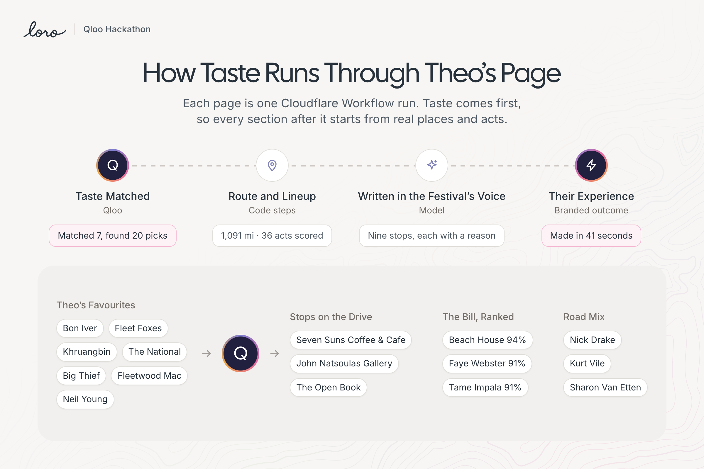

### Keeping the Writing Honest

Generated travel copy drifts towards the same words: "hidden gem", "vibrant", "unforgettable". Loro takes those choices away from the model.

- Sections can only recommend Qloo entities, by id.
- Code steps hand the model real facts: the route, the set times, the rooms in the listing.
- Each brand's voice lives in skills with a list of words it never uses, and an edit pass rewrites any that slip through.
- Repeat picks are removed, and so are places someone only passes through.

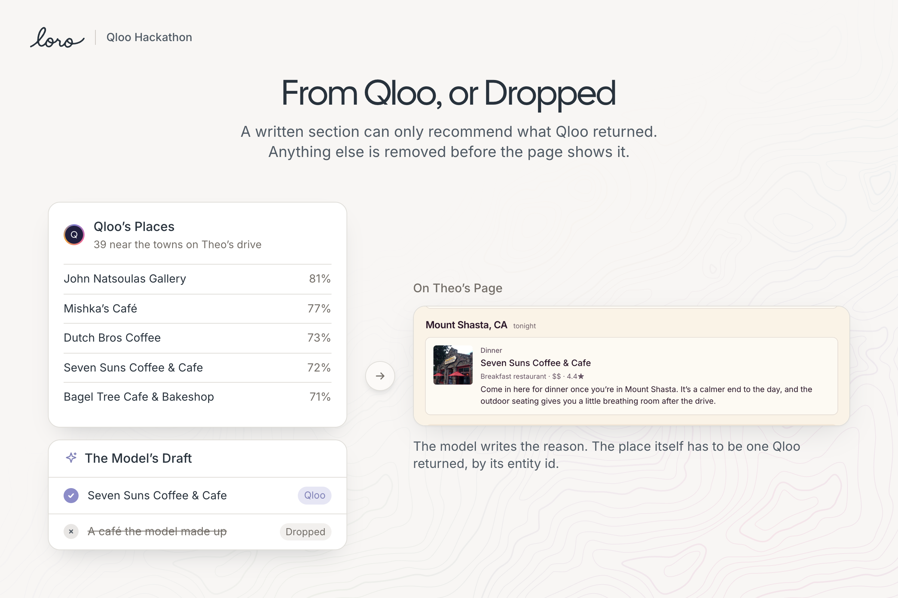

The festival pages end with "How this page was made", a table of every pick with the Qloo match behind it and why it's there.

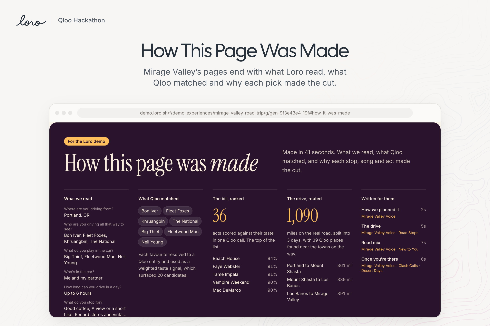

## What's in the Repo

```
worker/      The product: admin, public pages, REST API and MCP server, in one Cloudflare Worker
  workers/     Worker entry (Hono), API routes and the MCP server
  core/        Shared domain code; core/workflow/ holds the outcome workflow and its Durable Object
  app/         React Router app: admin and public routes, components, styles
  catalogues/  Component catalogues: festival, roadtrip, property, agency, stay, venue, date, basic
  steps/       Code steps an experience can run: route, lineup, listing, programme, date, weather, webhook
  themes/      Design tokens per brand theme
  migrations/  D1 schema, applied in order
site/        loro.sh, the public site (Next.js 16 static export)
.claude/     Claude Code launch configs and the loro-copy skill
```

[worker/README.md](worker/README.md) covers the internals in depth: catalogues, the headless form SDK, the outcome workflow, every API route, the agent and the admin password.

## Run It Locally

You need Node 22+, pnpm and a Cloudflare account. Each app installs on its own; there is no root workspace.

```sh
cd worker
pnpm install
npx wrangler login   # models, Images and Stream use your account even in local dev
pnpm dev             # applies D1 migrations, then http://localhost:5173/admin
```

A fresh database has no workspaces. Create one in the admin, with demo data or without.

Secrets go in `worker/.dev.vars`, which git ignores. All of them are optional:

```sh
QLOO_API_KEY=...       # without it, Qloo calls return nothing
ADMIN_PASSWORD=...     # makes the admin view only until unlocked (local dev never asks)
CF_ACCOUNT_ID=...      # Analytics Engine queries and Browser Rendering
CF_API_TOKEN=...       # Account Analytics: Read, Browser Rendering: Edit
POSTHOG_KEY=...        # PostHog project; only APP_HOST and PAGES_HOST report
```

Other commands, from `worker/`:

```sh
pnpm db:reset    # wipe the local database and reapply the migrations
pnpm typecheck   # wrangler types + react-router typegen + tsc
```

The site runs on its own:

```sh
cd site
pnpm install
pnpm dev         # http://localhost:3000
```

## Deploy

Loro deploys to the brand's own Cloudflare account, so every answer stays in the brand's own database.

### One Click

[](https://deploy.workers.cloudflare.com/?url=https://github.com/impactvelocity/loro-sh/tree/main/worker)

The button forks the repo into your GitHub account and deploys `worker/`. Add the secrets afterwards (below).

### From Your Machine

```sh
cd worker
pnpm install
npx wrangler login
pnpm run deploy      # builds, deploys and applies D1 migrations remotely
```

`wrangler.jsonc` gives D1, KV and R2 no IDs on purpose, so the first deploy creates each one in your account. There's nothing to set up by hand.

### Before You Go Live

1. **Turn on Images and Stream** in the Cloudflare dashboard. Uploads need both.
2. **Set the secrets**:

   ```sh
   npx wrangler secret put QLOO_API_KEY
   npx wrangler secret put ADMIN_PASSWORD   # strongly recommended on a public URL
   npx wrangler secret put CF_ACCOUNT_ID
   npx wrangler secret put CF_API_TOKEN
   npx wrangler secret put POSTHOG_KEY      # optional: your own PostHog project
   ```

3. **Check the vars** in `worker/wrangler.jsonc`:

   | Var | Default | Change it when |
   | --- | --- | --- |
   | `QLOO_API_URL` | `https://hackathon.api.qloo.com` | Your Qloo key is for a different host |
   | `AI_MODEL` | `anthropic/claude-sonnet-5.5` | You want another model for the admin agent (any AI Gateway catalog model or a Workers AI `@cf/…` id) |
   | `OUTCOME_MODEL` | `openai/gpt-5.4-mini` | You want another model writing the pages |
   | `AI_GATEWAY` | `default` | You use a different AI Gateway; it's created on first use |
   | `APP_HOST`, `PAGES_HOST` | `app.loro.sh`, `demo.loro.sh` | Always in a fork. Set your own domains or clear both to serve everything from one host |

4. **Add custom domains** (optional) in the Cloudflare dashboard under the Worker's Domains & Routes. With `APP_HOST` and `PAGES_HOST` set, the admin, API and MCP server answer on one host and the public pages on the other. `workers.dev` and any other host serve everything.

Model calls go through AI Gateway with no provider keys in the Worker: Workers AI models bill to the account, and other providers use AI Gateway's unified billing or keys stored on the gateway.

### The Site

`site/` is a static export. `pnpm build` writes plain files to `site/out/`, which any static host serves. Its outbound links live in `site/lib/links.ts`.

## Build Your Own Experience

An experience has three parts: a **start** page with the sign-up, the **intake** questions and the **artifact**, the page the person gets. Each part is built from a catalogue of React components, and the configuration is JSON in D1, so a brand's team changes copy, questions and photos in the admin without a developer.

- **A catalogue** (`worker/catalogues/<id>/index.ts`) lists the components each part can use. Each component declares its props as fields (`f.text`, `f.image`, `f.list` and so on), and each field becomes a control in the admin.
- **A code step** (`worker/steps/<name>.ts`) default-exports `defineStep({ type, name, at, fields, run })` and shows up in every experience's Workflow tab. `run` gets the person, their answers, `ctx.qloo` and `ctx.model`, and can hand candidates to the sections. Copy `steps/weather.ts` to start.
- **A theme** (`worker/themes/<name>.css`) sets the design tokens. Import it in `themes/index.css` and name it in the catalogue.
- **A custom design**: `useExperience` and `createExperienceClient` run the sign-up and questions from any React design. `/f/<workspace>/<slug>/plain` is a bare example built only on them.

Every code step opens with a comment that says what it does in order, so a coding agent can read one and write the next.

## API and MCP

Anything that changes a workspace needs one of its keys as `Authorization: Bearer loro_sk_…`. Make keys on the admin's Connect page.

Start an experience for someone from another system:

```sh
curl -X POST https://<your-host>/api/workspaces/<workspace>/experiences/<slug>/trigger \
  -H "Authorization: Bearer loro_sk_..." \
  -H "Content-Type: application/json" \
  -d '{ "person": { "name": "Theo", "email": "theo@example.com" }, "answers": { "...": "..." } }'
```

The MCP server at `/mcp` exposes 31 tools that call the same API in-process with the same key, so an agent can create an experience, test the draft and read the outcome. To connect Claude Code:

```sh
claude mcp add --transport http loro https://<your-host>/mcp --header "Authorization: Bearer loro_sk_..."
```

The admin's Connect page lists every endpoint and tool.

## Built With

[Cloudflare Workers](https://workers.cloudflare.com) · [Qloo](https://www.qloo.com) · [Hono](https://hono.dev) · [React Router v8](https://reactrouter.com) · [Base UI](https://base-ui.com) · [shadcn/ui](https://ui.shadcn.com) · [Tailwind CSS v4](https://tailwindcss.com) · [AI SDK](https://ai-sdk.dev) · [OSRM](https://project-osrm.org) · [Next.js](https://nextjs.org) · built with [Claude Code](https://claude.com/claude-code)

## License

[MIT](LICENSE). Fork it, deploy it to your own account and build your own experiences on it.

Made by [Dylan Jones](https://hidylanjones.com).
